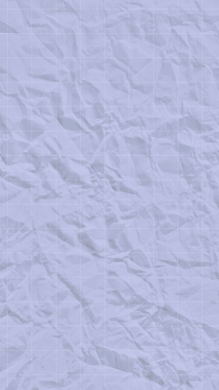

# Paper Collage skill for Claude Code

A Claude Code skill that makes vertical (1080x1920) paper collage videos: pastel crumpled paper with a grid, torn off-white strips whose serif letters type on, real photos cut out as stickers with a thick white border, paper objects drawn in code, marker doodles, and scenes that pop in and push up like stop motion. Rendered with [HyperFrames](https://github.com/heygen-com/hyperframes), so every frame is plain HTML and the output is deterministic.

<p align="center"></p>

The GIF is the bundled template rendered as is (17 seconds, three scenes). Your own video starts from the same template.

## Install

As a plugin (recommended, updates with `/plugin update`):

```
/plugin marketplace add rafiimanggala/paper-collage-skill
/plugin install paper-collage@paper-collage
```

Or copy the skill folder by hand:

```bash
git clone https://github.com/rafiimanggala/paper-collage-skill
cp -R paper-collage-skill/skills/paper-collage ~/.claude/skills/
```

## Use

Ask Claude for the video in plain words. The skill loads on its own when the request matches, or call it directly with `/paper-collage:paper-collage` (plugin install) or `/paper-collage` (manual install).

```
Make a 20 second paper collage reel about moving house: three scenes,
"packing a" / "finding a" / "unpacking a", stressed people, a new paper colour per scene.
```

```
Turn this voiceover into a scrapbook style ad and put each punch word on the spoken word.
Keep it under 30 seconds without cutting anything.
```

Claude copies the template into your project, writes a storyboard table, finds CC0 photos and cuts them into stickers, edits one Python file, then checks and snapshots the frames before it renders.

## Requirements

- Claude Code
- Node.js 22 or newer, and ffmpeg
- Python 3.9 or newer; the photo scripts also need `pip install pillow numpy scipy`
- The HyperFrames skills: `npx hyperframes skills update`

## What is inside

```
skills/paper-collage/
  SKILL.md              workflow, beat table, look checklist, common mistakes
  reference/            full style spec, asset sourcing guide, markup contract
  scripts/
    diecut.py           photo to sticker, prop cutout or framed print
    paper_texture.py    any paper photo to a clean multiply texture
    openverse_search.py search CC0 and public domain images
  template/             a working HyperFrames project (the demo above)
    scripts/scenes.py   the storyboard: the only file you edit
    scripts/build.py    writes compositions/*.html, index.html, captions, audio
    assets/lib/         collage.js animation library, styles, paper documents
```

## How it works

- One storyboard in `scenes.py` describes every scene as a list of elements (label, document, sticker, word, doodle) with scene-local start times.
- `build.py` turns it into one HyperFrames sub-composition per scene, chains them with a 0.4 second push overlap, and adds typing, pop and whoosh sound cues from the markup.
- `collage.js` renders every element as a pure function of time, so scrubbing, snapshots and renders always agree.
- `CONFIG["target_seconds"]` speeds the whole piece up to a length without cutting anything, and a voiceover is time-stretched with its pitch kept.
- A scene can be a talking head video instead of paper, with the same strips and stamps on top.

## Credits and licenses

- Code: MIT, see [LICENSE](LICENSE).
- Fonts: Gloock, Newsreader and Archivo Black from Google Fonts, SIL Open Font License 1.1 (license files next to the fonts).
- Example photos and the paper texture: CC0, from StockSnap and rawpixel via [Openverse](https://openverse.org). Sources are listed in `template/assets/credits.md`.
- Sound effects are not bundled. The build copies them from the HyperFrames media-use skill if it is installed (Pixabay Content License), or from a folder you point `PAPER_COLLAGE_SFX` at.
- Built on [HyperFrames](https://github.com/heygen-com/hyperframes) (Apache 2.0). This project is not affiliated with HeyGen or Anthropic.
